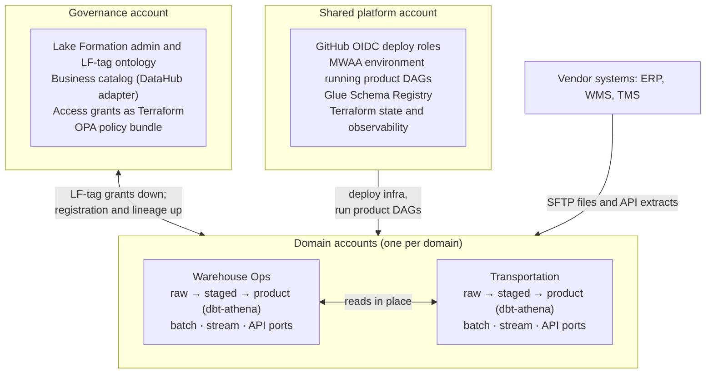

# meshlane architecture proposal

Status: accepted for Phase 0 · Last updated: 2026-11-17

## Overview

meshlane is an Apache-2.0 reference implementation and template set that lets a logistics organization stand up a data mesh on AWS from zero. It ships platform modules, data product templates and governance policies that novice domain teams can use with help from an enabling data-engineering team.

**In scope for v1**

- Greenfield deployment on AWS-native services plus open-source tools
- Data products sourced from vendor systems (ERP, WMS, TMS) through file and API extracts, and products built by internal teams
- Batch, streaming and API output ports
- Terraform for infrastructure, GitHub Actions for CI/CD, MWAA (Airflow) for orchestration
- A business catalog the blueprint can create, or an existing one it registers into
- A deployable example: a fictional third-party logistics provider (3PL) with synthetic data

**Designed for, built later**

- Migration from an existing central lakehouse or warehouse (register-only ports, strangler pattern)
- Direct database CDC from vendor systems
- A developer portal (Backstage)

**Non-goals**

- AWS landing zone or account vending: the blueprint assumes an AWS Organization already exists
- Multi-cloud support in v1
- Vendor-specific connectors maintained as product code (connectors are examples and patterns)

**Audience**: platform and data-engineering teams that adopt and run the blueprint, and domain teams that build products with its templates.

## Decision log

All decisions are recorded as ADRs in [`adr/`](adr/).

| ADR | Decision |
| --- | --- |
| [001](adr/001-existing-aws-organization.md) | Assume an existing AWS Organization; no landing zone |
| [002](adr/002-repo-per-data-product.md) | One repo per data product, generated from a template; monorepo optional |
| [003](adr/003-self-managed-iceberg.md) | Self-managed Apache Iceberg on S3 general-purpose buckets; S3 Tables opt-in later |
| [004](adr/004-kinesis-first-streaming.md) | Kinesis Data Streams first; MSK Serverless as a second module |
| [005](adr/005-mwaa-orchestration.md) | MWAA (managed Airflow) for orchestration |
| [006](adr/006-file-and-api-extracts-only.md) | Vendor sources arrive as file and API extracts only; no CDC in v1 |
| [007](adr/007-classification-tiers.md) | Classification tiers with column masking for PII; no specific regulation encoded |
| [008](adr/008-tiered-cross-domain-access.md) | Internal data auto-granted across domains; higher tiers need owner approval |
| [009](adr/009-datahub-first-catalog.md) | DataHub first business catalog adapter; SageMaker Catalog second |
| [010](adr/010-cli-first-developer-experience.md) | CLI-first developer experience; Backstage scaffolder later |
| [011](adr/011-apache-2-license.md) | Apache-2.0 license |
| [012](adr/012-bitol-odps-odcs.md) | Descriptor = Bitol ODPS v1.1.0; contracts = Bitol ODCS v3.2.0; schemas vendored and pinned; platform bindings as extensions |
| [013](adr/013-glue-lake-formation-technical-layer.md) | Glue Data Catalog + Lake Formation are always the technical catalog and enforcement layer |

## Architecture

The mesh runs across three kinds of AWS account: one governance account, one shared platform account, and one account per domain. Data never moves between accounts to be shared; Lake Formation grants access in place.



### Accounts

| Account | Holds | Owned by |
| --- | --- | --- |
| Governance | Central Glue catalog view, Lake Formation admin, LF-tag ontology, business catalog (DataHub), policy bundle | Platform team |
| Shared platform | CI deploy roles (GitHub OIDC), MWAA environment, schema registry, observability, Terraform state | Platform team |
| Domain (one each) | Raw and product S3 buckets, Glue databases, Iceberg tables, streams, APIs, product compute | Domain team |

One MWAA environment in the platform account runs all DAGs at first. DAGs assume a per-product role in the domain account, so a domain never holds MWAA. A per-domain MWAA option is an open question.

### Platform layers

1. **Foundation**: account baselines, KMS keys, Lake Formation settings, LF-tags, GitHub OIDC roles, cost-allocation tags.
2. **Ports**: one Terraform module per output port type, consumed by product repos at a pinned version.
3. **Ingestion**: modules for file drops and API pulls.
4. **Catalog**: an adapter interface with interchangeable implementations.
5. **Governance**: OPA policies and reusable GitHub workflows that every product runs.

### Output ports

| Port | Storage and serving | Contract artifacts | Consumer access |
| --- | --- | --- | --- |
| Batch | Iceberg tables on S3, Glue catalog | ODCS | Lake Formation grant by LF-tag; query with Athena, Glue, EMR |
| Stream | Kinesis Data Streams + Glue Schema Registry | ODCS + AsyncAPI | IAM read role per subscribing consumer |
| API | API Gateway + Lambda over DynamoDB (key lookups) or Aurora Serverless (filtered queries) | ODCS + generated OpenAPI | Usage plan + API key or IAM auth per consumer |

The API port reads from a serving store fed by the product pipeline, not from Athena. Track-and-trace and ETA lookups need millisecond reads that Athena does not provide.

### Catalog adapter

Every adapter implements four operations: register a product, publish a port, sync owners and glossary terms, and record subscriptions. One Terraform variable selects the mode:

```hcl
catalog = {
  mode     = "create"   # or "existing"
  provider = "datahub"  # sagemaker-catalog | openmetadata | external | none
  endpoint = null       # required when mode = "existing"
}
```

`create` deploys DataHub on ECS Fargate in the governance account. `existing` registers into a catalog the adopter already runs. The SageMaker Catalog adapter follows in Phase 4; SageMaker Catalog is built on Amazon DataZone.

### Toolchain

| Concern | v1 choice | Escape hatch |
| --- | --- | --- |
| Transformation | dbt-core with dbt-athena (Iceberg) | Spark on Glue or EMR Serverless |
| Orchestration | MWAA, one DAG per product, generated from the descriptor | Custom DAG at Tier 3 |
| Contract tests | datacontract-cli against ODCS | — |
| Data quality | dbt tests generated from contract rules; Soda Core optional | Custom checks |
| Lineage | OpenLineage from dbt and Airflow, sent to the active catalog | — |
| Policy | OPA / Conftest on descriptor, contracts and Terraform plan | — |
| Local development | dbt on DuckDB with sample data | — |

## Repository layout

The project is one public monorepo that releases versioned parts; each adopter's data product lives in its own repo generated from a template.

### Blueprint monorepo

```
meshlane/
├── platform/
│   ├── foundation/          # governance, platform and domain account baselines
│   ├── ports/
│   │   ├── iceberg-table/
│   │   ├── kinesis-stream/
│   │   └── api/
│   ├── ingestion/
│   │   ├── file-drop/       # S3 landing + Transfer Family SFTP + EventBridge
│   │   └── api-pull/        # Lambda/Fargate pullers with secrets and checkpoints
│   ├── orchestration/       # MWAA environment + per-product role pattern
│   └── catalog/
│       ├── interface/       # adapter contract and conformance tests
│       ├── datahub/
│       └── sagemaker-catalog/   # Phase 4
├── templates/               # Copier templates
│   ├── source-aligned/
│   ├── internal/
│   └── consumer-aligned/
├── schemas/                 # ODPS/ODCS extension JSON Schemas
├── vocabulary/              # logistics glossary + shared identifiers
├── policies/                # Rego + plain-language messages + tests
├── .github/workflows/       # reusable workflows called by product repos
├── cli/                     # meshlane CLI (Python)
├── examples/logistics-3pl/  # fictional company, synthetic data generators
└── docs/                    # tutorials, how-tos, reference, explanation, adr/
```

### Generated product repo

```
wms-shipments/
├── data-product.yaml        # ODPS descriptor + x-platform bindings
├── contracts/
│   └── shipments.odcs.yaml  # one contract per output port
├── ingest/                  # extract config (file pattern or API spec)
├── transform/               # dbt project
├── quality/                 # extra checks beyond the contract
├── infra/main.tf            # module calls only, pinned versions
├── .github/workflows/ci.yml # calls meshlane reusable workflows
├── .copier-answers.yml      # enables template updates
└── docs/README.md
```

### Versioning

| Part | Released as | Consumers pin by |
| --- | --- | --- |
| Terraform modules | Git tags per module, semver (`ports/iceberg-table/v1.4.0`) | `source = "...?ref=..."` |
| Reusable workflows | Git tags | `uses: dringwala/meshlane/.github/workflows/ci.yml@v1` |
| Templates | Git tags | `copier update --vcs-ref` |
| Extension schemas | Versioned `$id` URLs | `apiVersion` in descriptor |
| CLI | PyPI package | Pinned in workflow |

A breaking change in any part requires a major version and a migration note. Renovate in product repos proposes upgrades.

## Descriptor and contracts

Each product declares itself in one ODPS file and one ODCS contract per output port; meshlane adds only what the standards leave to implementers, under `customProperties`. CI derives infrastructure, the DAG, LF-tags, catalog entries and tests from these files, so a Tier 1 team writes YAML and SQL and nothing else.

### What meshlane adds

| Extension key | On | Drives |
| --- | --- | --- |
| `x-platform.tier` | Product | Which golden-path checks apply (1, 2 or 3) |
| `x-platform.sourceSystem` | Product | Source type (`erp`, `wms`, `tms`, `internal`) and vendor, for anti-corruption mapping |
| `x-platform.ingestion` | Input port | `file-drop` or `api-pull` module and its settings |
| `x-platform.port.type` | Output port | `iceberg-table`, `kinesis-stream` or `api` module |
| `x-platform.schedule` | Product | MWAA DAG schedule |
| `x-platform.costCenter` | Product | Cost-allocation tags |

Column classification needs no extension: the native ODCS `classification` property carries the tier (`public`, `internal`, `confidential` or `restricted`) and drives the LF-tag value and column masking. The extension schema lives in [`schemas/x-platform/`](../schemas/x-platform/); it checks the shape of the block, while cross-references (for example, that ingestion keys match input port names) are checked by OPA policies.

### Example: WMS shipments product

```yaml
# data-product.yaml (ODPS v1.1.0)
apiVersion: v1.1.0
kind: DataProduct
id: warehouse-ops.wms-shipments
name: WMS Shipments
version: 1.2.0
status: active
domain: warehouse-ops
type: sourceAligned
team:
  name: Warehouse Ops data team
  members:
    - username: wh-data-owner@example.com
      role: owner
inputPorts:
  - name: wms-daily-extract
    version: 1.0.0
    contractId: warehouse-ops.wms-raw-shipments
outputPorts:
  - name: shipments
    version: 1.2.0
    contractId: warehouse-ops.shipments
  - name: shipment-events
    version: 1.0.0
    contractId: warehouse-ops.shipment-events
customProperties:
  - property: x-platform
    value:
      tier: 1
      sourceSystem: { type: wms, vendor: generic }
      schedule: "0 * * * *"
      costCenter: WH-OPS
      ingestion:
        wms-daily-extract: { module: file-drop, pattern: "shipments_*.csv", via: sftp }
      ports:
        shipments: { type: iceberg-table, partitionBy: [ship_date] }
        shipment-events: { type: kinesis-stream, shards: 1 }
```

```yaml
# contracts/shipments.odcs.yaml (ODCS v3.2.0)
apiVersion: v3.2.0
kind: DataContract
id: warehouse-ops.shipments
version: 1.2.0
status: active
domain: warehouse-ops
dataProduct: wms-shipments
schema:
  - name: shipments
    physicalType: table
    quality:
      - metric: rowCount
        mustBeGreaterThan: 0
    properties:
      - name: shipment_id
        logicalType: string
        primaryKey: true
        required: true
        classification: internal
        quality:
          - metric: duplicateValues
            mustBe: 0
      - name: sscc
        logicalType: string
        description: GS1 Serial Shipping Container Code
        classification: internal
        customProperties:
          - { property: x-vocabulary, value: gs1.sscc }
      - name: ship_from_gln
        logicalType: string
        classification: internal
        customProperties:
          - { property: x-vocabulary, value: gs1.gln }
      - name: consignee_name
        logicalType: string
        classification: restricted
      - name: ship_date
        logicalType: date
        required: true
        classification: internal
slaProperties:
  - property: freshness
    value: 2
    unit: h
```

Both files validate against the vendored ODPS v1.1.0 and ODCS v3.2.0 schemas and the `x-platform` extension schema; see the [validation spike](spikes/oq-03-odps-odcs-validation/README.md) and its `validate.py`. The upstream schemas are pinned in [`schemas/upstream/`](../schemas/upstream/) because upstream edits released versions in place.

### Contract versioning rules

- Adding an optional column is a minor version.
- Removing or renaming a column, changing a type, or tightening a rule is a major version.
- A major version publishes a new output port version beside the old one; the old one stays for a deprecation window set in the descriptor.
- CI runs `datacontract breaking` against the last released contract. It exits 1 on a breaking change (removed column, changed type), but it does not read version numbers, so a small wrapper fails the build unless the major version increased. (`datacontract changelog` only lists differences and always exits 0.)

## Ingestion patterns

v1 supports exactly two ways in, file drops and API pulls, because the reference must run without network access to vendor systems. Both land raw data unchanged, then a staging layer maps vendor terms into the domain's language.

| Pattern | Typical logistics source | AWS services | Landing format |
| --- | --- | --- | --- |
| File drop, SFTP | WMS and TMS nightly exports, EDI X12 (856 ASN, 214 status, 940/945 warehouse orders) | Transfer Family SFTP → S3 raw bucket → EventBridge → MWAA sensor | Original file, partitioned by arrival date |
| File drop, S3 | Vendor-pushed CSV or Parquet, cross-account | S3 bucket policy for vendor role → EventBridge | Same |
| API pull | SaaS ERP or TMS REST/OData, carrier tracking APIs | Lambda (small) or Fargate task (large) on an MWAA schedule; Secrets Manager; checkpoint in DynamoDB | JSON lines, partitioned by extract time |

### Layers inside a source-aligned product

1. **Raw**: the vendor's bytes, immutable, retained per descriptor setting; never an output port.
2. **Staged**: parsed and typed, vendor column names kept; an EDI parser turns X12 segments into rows here.
3. **Product**: the anti-corruption mapping into domain terms and shared identifiers; only this layer is published.

The mapping in step 3 is a dbt model per vendor. Swapping one WMS vendor for another changes one model, and consumers see the same contract.

### What every ingestion module provides

- Idempotent reloads: the same file or extract window can be processed twice without duplicates
- A manifest per batch (file name, row count, checksum) checked before staging
- Quarantine of malformed files with an alert to the product owner
- Backfill by date range from the CLI

CDC from vendor databases (DMS) is a later module behind the same `x-platform.ingestion` key, so adding it does not change product repos.

## Governance as code

Governance is a set of OPA policies run in every product's CI and a classification scheme that Lake Formation enforces at query time. A product cannot deploy until its policies pass.

### Classification tiers

| Tier | Examples in logistics | Lake Formation treatment | Cross-domain access |
| --- | --- | --- | --- |
| Public | Facility list, carrier codes, service levels | LF-tag `classification=public` | Granted to all domains automatically |
| Internal | Shipment volumes, on-time metrics, inventory positions | `classification=internal` | Granted to all domains automatically |
| Confidential | Rates, contract terms, customer-level cost-to-serve | `classification=confidential` | Owner approval per consumer |
| Restricted | Driver identity, consignee name and address, precise GPS traces | `classification=restricted`; columns masked or excluded via data cell filters | Owner approval plus a stated purpose; time-boxed grant |

A table's tier is the highest tier of any of its columns. Restricted columns are excluded from the default grant, so a consumer approved for the table sees them only with an explicit column grant.

### Access flow

1. The consumer runs `meshlane subscribe <product>/<port>` or requests it in the catalog.
2. Public and internal: a workflow in the governance repo applies the LF-tag grant at once and records it.
3. Confidential and restricted: the workflow opens a pull request assigned to the product owner; merge applies the grant.
4. Every grant lives in Terraform in the governance repo, so access is auditable and revocable by revert.

### Starter policies

| Policy | Fails when |
| --- | --- |
| `owner-required` | Descriptor has no owner or the owner is not in the domain's team list |
| `contract-per-port` | An output port has no ODCS contract |
| `classification-required` | Any contract property lacks a classification |
| `pii-not-public` | A property tagged with a PII vocabulary term is classified public or internal |
| `semver-breaking` | A breaking contract change is not a major version |
| `module-pinned` | `infra/` uses an unpinned or unapproved module source |
| `no-raw-port` | A raw or staged layer is exposed as an output port |
| `freshness-sla` | A batch port has no freshness SLA |
| `tags-present` | A Terraform resource lacks domain, product or cost-center tags |

Each policy carries a plain-language message and a docs link that CI posts as a pull-request comment.

## Developer experience

A novice domain team should ship its first product by editing YAML and SQL only, with the enabling data-engineering team reviewing rather than building. Everything else is generated, checked or explained by the tooling.

### Golden-path tiers

| Tier | The team writes | The platform generates | Review required |
| --- | --- | --- | --- |
| 1 | Descriptor, contracts, dbt SQL models | Terraform calls, MWAA DAG, tests, catalog entry, grants | Data engineering on first 3 releases |
| 2 | Tier 1 + Python or Spark jobs | Same, plus job packaging | Data engineering on every release touching jobs |
| 3 | Tier 2 + custom Terraform via extension points, custom DAGs | Policy checks only | Platform team |

The tier is declared in the descriptor; policies enforce that a Tier 1 repo contains no custom Terraform or DAG code.

### meshlane CLI

| Command | Does |
| --- | --- |
| `meshlane new <template>` | Runs Copier with guided prompts, creates the repo |
| `meshlane validate` | Schema, policy and contract checks locally, same as CI |
| `meshlane dev` | Runs dbt against DuckDB with the product's sample data |
| `meshlane render` | Shows the Terraform, DAG and tests the descriptor produces |
| `meshlane subscribe` | Requests access to another product's port |
| `meshlane backfill` | Reprocesses a date range |
| `meshlane scorecard` | Prints the product's maturity score |
| `meshlane update` | Applies the latest template version via `copier update` |

### CI pipeline (reusable workflow)

1. **Validate**: JSON Schema on descriptor and contracts, OPA policies, `datacontract lint`.
2. **Build**: dbt compile; render Terraform and DAG.
3. **Test**: dbt tests on DuckDB sample data; contract tests; breaking-change check.
4. **Plan**: `terraform plan` per environment; Conftest on the plan; plan posted to the PR.
5. **Deploy**: on merge, apply to dev, then prod behind a GitHub environment approval.
6. **Publish**: register or update the catalog entry, emit lineage, sync DAG to MWAA.

### Scorecard

A product moves from **draft** to **trusted** as it meets these checks: owner and description set, every port contracted, freshness SLA met for 14 days, quality checks on every primary key, docs page filled, at least one consumer. Reaching trusted removes the mandatory data-engineering review for Tier 1. The 14-day and other thresholds are starting values for adopters to tune.

### Documentation

Docs follow the Diátaxis split: tutorials (build your first product in an hour), how-tos (add a stream port, onboard a new vendor), reference (descriptor fields, modules, policies), explanation (why the mesh is shaped this way).

## Reference example

The example is a fictional 3PL with four domains and six products, small enough to deploy in one sandbox and broad enough to exercise every template, port type and access tier.

| Domain | Product | Template | Source | Ports | Highest tier |
| --- | --- | --- | --- | --- | --- |
| Order Management | Customer Orders | source-aligned | ERP API pull (synthetic OData) | Batch | Confidential |
| Warehouse Ops | WMS Shipments | source-aligned | WMS SFTP CSV + EDI 945 | Batch, stream | Restricted |
| Warehouse Ops | Inventory Positions | internal | Built from WMS staged data | Batch, API | Internal |
| Transportation | Load Tracking | source-aligned | TMS API pull + EDI 214 files | Batch, stream, API | Restricted |
| Transportation | Carrier Performance | internal | Built from Load Tracking | Batch | Internal |
| Customer Analytics | OTIF and Cost-to-Serve | consumer-aligned | Orders + Shipments + Load Tracking | Batch | Confidential |

### Shared logistics vocabulary

The `vocabulary/` folder defines entities that cross domains and the identifiers that join them. Contracts reference terms by key, as in the WMS example above.

| Entity | Shared identifier | Defined by |
| --- | --- | --- |
| Item | GTIN | GS1 |
| Location / facility | GLN | GS1 |
| Handling unit | SSCC | GS1 |
| Order | Order ID + source system | Order Management |
| Shipment | Shipment ID | Warehouse Ops |
| Load | Load ID | Transportation |
| Carrier | SCAC | NMFTA |

### Synthetic data

Generators produce orders, shipments and loads that join correctly across domains, plus deliberate defects (late files, duplicates, schema drift) so tutorials can show quality checks and quarantine firing. All personal data is fake.

### Running it

- `make example-up` deploys all four domains into accounts named in one config file.
- `make example-down` destroys everything, including DataHub.
- The README states the expected monthly cost; it is measured in Phase 2, not estimated here.

## Roadmap

Templates are extracted in Phase 4 from three working phases, not designed up front; no dates are set until Phase 0 spikes size the work.

| Phase | Delivers | Exit gate |
| --- | --- | --- |
| 0 · Foundations | ADRs 001–013, extension JSON Schemas, naming and tagging conventions, account baseline modules; spikes on DataHub footprint, ODPS/ODCS validation, environment layout, single region | WMS example files validate; foundation applies cleanly to three sandbox accounts |
| 1 · First thin slice | WMS Shipments batch product end to end (SFTP drop, staging, dbt-athena, Iceberg port); MWAA DAG generated from the descriptor; reusable CI with policies and contract tests | A consumer account queries the product through Lake Formation; CI blocks a breaking change |
| 2 · Mesh behavior | Transportation domain, Order Management ERP pull, Customer Analytics consumer-aligned product; DataHub adapter, subscription workflow, lineage, scorecard v1 | The OTIF product runs on schedule across three domains; example cost measured |
| 3 · Stream and API ports | Kinesis stream and API port modules, schema registry, AsyncAPI and OpenAPI generation; restricted-field handling outside Lake Formation | Load Tracking serves batch, stream and API ports from one contract |
| 4 · Templates and v1.0 | Copier templates extracted from Phases 1–3, CLI, template updates, Diátaxis docs; SageMaker Catalog adapter; public v1.0 release | A new team ships a Tier 1 product from the tutorial with no platform code changes |
| 5 · Migration track | Register-only ports for existing Glue tables and Redshift views; lakehouse onboarding guide; DMS CDC ingestion module | An existing table is published as a product without moving data |

Phases 0–2 are the minimum for a credible first public preview; Phases 3–5 can be reordered by adopter demand.

## Open questions

See [open-questions.md](open-questions.md).

## References

- [Bitol ODPS v1.0.0 announcement](https://bitol.io/announcing-odps-v1-0-0-building-the-language-of-data-products/)
- [Open Data Contract Standard](https://github.com/bitol-io/open-data-contract-standard)
- [Amazon SageMaker Catalog](https://aws.amazon.com/sagemaker/catalog/)
- [One Iceberg table for ninety sites, on S3 Tables (AWS Builder Center)](https://builder.aws.com/content/3KMwlGHVwJRX5xk0SfHQKFL0611/one-iceberg-table-for-ninety-sites-on-s-tables)
